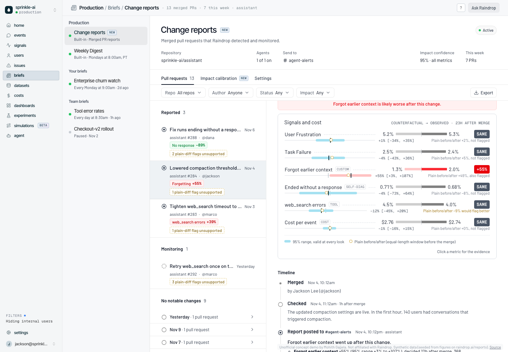

# Change Impact for Raindrop Change Reports

**Live demo:** https://mohith26.github.io/raindrop-change-impact/ (unofficial concept, synthetic data)

Raindrop's [Change Reports](https://raindrop.ai/docs/platform/change-reports.md) watch the traffic after every merged PR and compare it with "an equal-length window before the change". That comparison mixes the change with everything else that differs between the two windows: time of day, weekends, the free/pro/team mix, a PR merged three hours earlier, and plain noise, and it is read twice (early check and full report). **Change Impact** gives every metric in a Change Report a counterfactual for the same hours and traffic mix, a range that stays valid at every look and for all metrics together, and attribution across stacked merges. On 400 simulated merges that changed nothing, the plain before/after flagged **95.8%** of them; Change Impact flagged **1 (0.25%)**.



## What it adds to the product

- **Impact section** on each PR in Briefs > Change reports: every signal (User Frustration, Task Failure, custom signals, tool errors) and cost per event, counterfactual vs. observed, a range, and a verdict (likely worse / likely better / same), in the same visual language as Experiments.
- **As of** control: early check (1 h), 6 h, full report (24 h), latest. The ranges are valid at all of them at once, so looking early does not raise the false-alarm rate.
- **The plain before/after next to it**, so you can see when the equal-window comparison would have flagged a metric that is within normal variation (and why: weekend, hour of day, plan mix).
- **Evidence drill-down** per metric: the effect over hours with its range, observed vs. expected counts, the baseline used, which earlier PRs were factored in, overdispersion and day-to-day drift, sample conversations, and a planner ("a 10% change needs about N hours at this traffic; changes under ±X% can't be resolved with this baseline").
- **Impact calibration** tab with the backtest below, plus a button that runs 60 more no-op merges in your browser with the same code.
- Mark as (investigating / expected / revert planned), Slack report preview with the impact lines, CSV/JSON export, deep links (`?pr=284&metric=forgetting&look=full`), saved state, keyboard shortcuts (`j`/`k`, `1`-`4`, `↑`/`↓`, `m`, `s`, `e`, `c`, `?`).

## How it works

For each merged PR and each metric (`src/impact.js`):

1. **Counterfactual profile.** Fit `rate[plan, hour-of-day x weekend] = a[plan] * b[hour, weekend]` by raking (a two-way Poisson log-linear model) on the 28 days before the merge.
2. **Level.** Scale the profile to the 48 hours before the merge. If another PR merged inside that window, the hours before it are rescaled by that PR's own estimated effect, so an earlier change is not blamed on this one (stacked-merge attribution).
3. **Commit-scoped window.** Only traffic on this PR's commit counts (until the next merge), which is what `raindrop.app.commit_sha` already gives Change Reports.
4. **Anytime-valid range.** `S_t = observed - expected` is a running sum over hourly cells. A two-sided Gaussian-mixture confidence sequence (Robbins; Howard, Ramdas, McAuliffe and Sekhon 2021) on `S_t`, with intrinsic time inflated by the overdispersion fitted on the baseline, holds at every hourly look. Baseline uncertainty (level, profile shape, and day-to-day drift net of sampling, estimated from day-over-day changes that don't straddle a merge) gets its own normal bound. The error budget is split across the metrics (Bonferroni), so one 95% statement covers the whole report.
5. **Planner.** Projects the range forward at the current traffic to give hours-to-detect for a chosen change size, and the floor set by the baseline.

The plain comparison shown for reference (`naiveCompare`) is the equal-length window before vs. the window after, a two-sample z test at 95%, read at the early check (1 h) and the full report (24 h).

## Results

All numbers come from `results/results.json`, produced by `node scripts/generate.mjs && node scripts/backtest.mjs 400`; a unit test recomputes the headline from scratch.

**No-op merges (400, random times across weekdays, nights, weekends; 6 metrics; 24 h):**

| Method | Merges with any false alarm |
|---|---|
| Plain before/after (early check + full report) | 383 / 400 (95.8%) |
| Same adjusted estimate, plain 95% interval checked hourly | 84.3% |
| **Change Impact** (anytime-valid, all metrics) | **1 / 400 (0.25%)** |

**Planted changes (100 merges each):**

| Change | Caught in 24 h | by 72 h | Median hours to decide |
|---|---|---|---|
| Ended without a response -80% | 99% | 100% | 10 |
| Forgot earlier context +45% | 73% | 92% | 11 |
| web_search errors +35% | 67% | 87% | 13 |
| Task Failure +30% | 29% | 66% | 13 |
| User Frustration +25% | 21% | 58% | 13 |
| Cost per event -8% | 26% | 40% | 13 |

The plain comparison "catches" 85-100% of these, but it also flags 89-95% of the *other* metrics in the same merges, so its flags carry little information.

**Stacked merges** (a real +50% forgetting regression, then a no-op PR 6 h later): the second PR was blamed 83% of the time by the plain comparison, 56% by the adjusted estimate without attribution, and 0% with attribution.

**Demo project** (13 PRs x 6 metrics, ground truth known): the plain comparison raised 32 flags, 27 of them wrong. Change Impact raised 3, all correct (#283 web_search errors +39%, #284 forgot earlier context +55%, #288 ended without a response -89%), and left the three smaller or shorter-window planted changes as "same" with their ranges shown.

## Honest limitations

- **Synthetic data.** Real customer traffic is private. The generator (`scripts/model.mjs`, `scripts/generate.mjs`) simulates 1,066 hours of event-level traffic with hour-of-day and weekend seasonality, a plan mix that shifts at nights and weekends, Zipf-distributed users with per-user frailty, hourly and day-level random effects, and 13 PRs with planted effects. It is seeded from figures on Raindrop's own Change Reports page (238 users hitting compaction within ~48 minutes, a ~$1,048 cost window, "i said that already" quotes). The backtest uses a faster cell-level sampler of the same model.
- **Conservative by design.** Splitting the error budget across metrics and looks costs power: a +25% frustration change is caught in 24 h only 21% of the time (58% by 72 h). The verdict for anything smaller is "same, with this range", which is the honest answer from one day of pre/post data.
- **Approximations.** The confidence sequence treats hourly increments as conditionally Gaussian with variance inflated by a fitted overdispersion factor (asymptotically valid; checked by simulation: at 24 h the standardized error has SD 0.94-1.00 for signals and 1.16 for cost, which is heavier-tailed). Baseline drift is estimated from 28 days and is noisy for rare signals. Profile errors are treated as independent across cells.
- **Not causal identification.** Without a concurrent control (no canary split), anything else that changes at the merge time (a provider incident, a marketing email) is attributed to the PR. Stacked-merge attribution only handles other merges of the same agent.
- **Single agent, hourly cells.** Multi-agent PRs, user-level metrics (Users %) and percentiles (p95 latency) are not implemented.

## Prior art and what is new here

- Raindrop **Experiments** already reports a 95% interval and p-value for two cohorts, and **Issue Detection** forecasts each metric and flags deviations. Change Reports itself is a narrative comparison against an equal-length window with no interval. Change Impact applies counterfactual adjustment, anytime validity and stacked-merge attribution to the merged-PR view specifically.
- **LaunchDarkly guarded rollouts** use frequentist sequential testing with multiple-comparison correction, but compare against a concurrent control variation (they require an equal traffic split). **Datadog Faulty Deployment Detection** compares a new version with previous versions using rules over the first ~15-60 minutes. Neither handles a 100% merge with no concurrent control, LLM-classifier signal rates, or attribution across stacked merges.
- The statistics are standard (confidence sequences: Robbins 1970, Howard et al. 2021, Waudby-Smith et al. 2023; raking / log-linear models). The combination for agent change monitoring is, as far as I could find, new.

## Run it

```bash
node --test test/impact.test.mjs        # 16 tests: CS coverage (randomized), unbiasedness, mix-shift and stacked-merge cases, headline numbers
node scripts/generate.mjs               # data/project.json + demo section of results/results.json
node scripts/backtest.mjs 400           # backtest section of results/results.json (~8 s)
python3 -m http.server 8000             # then open http://localhost:8000
```

No build step and no dependencies; the page loads Barlow and Geist Mono (Raindrop's app fonts) from Google Fonts and Lucide icons from unpkg. Raindrop's heading font is licensed, so Inter Tight stands in.

Unofficial concept demo by Mohith Gajjela. Not affiliated with Raindrop.
